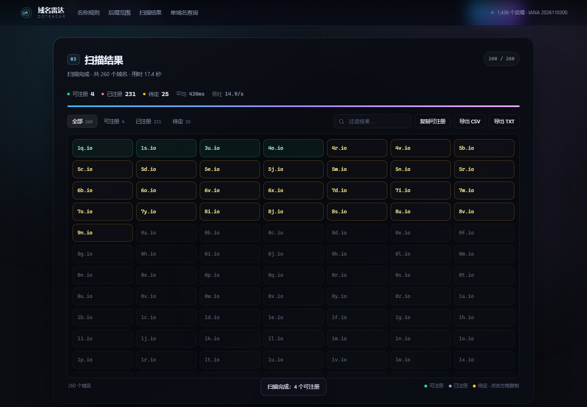
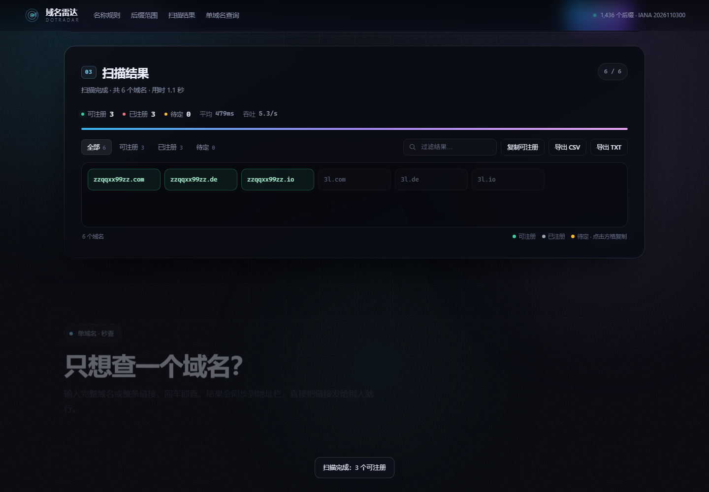
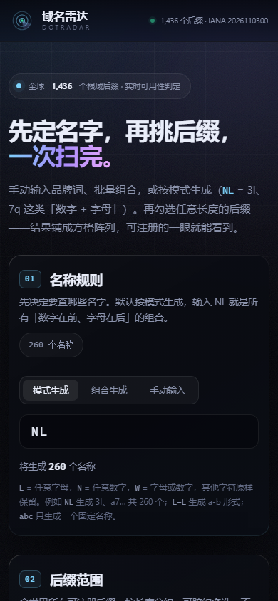

# 域名雷达 DotRadar

全世界 **1,436 个根域后缀**（IANA 全量，含 151 个国际化后缀）的域名可用性查询工具：
手动单查、按后缀长度批量扫描、组合生成短域名，结果直连注册局判定。

纯静态前端 + Cloudflare Worker API，**无登录、秒打开、零数据库**。

**[在线体验 →](https://domain-radar.1833179087.workers.dev)** ｜ MIT License

[](docs/video/dotradar-intro.mp4)

> 50 秒演示：`docs/video/dotradar-intro.mp4`（无声，B 站可自行配音/配乐）

---

## 能力

| 能力 | 说明 |
| --- | --- |
| 单域名秒查 | 输入 `3l.nz`、`例子.中国` 或整条链接，回车即查；结果同步到 `?d=` 深链，可直接分享 |
| 后缀全景选择 | 2 / 3 / 4 位及以上 / 国际化 / 热门 五个分组（最短后缀就是 2 位），1436 个后缀全部可选、可搜索、可多选 |
| 只显示可公开注册 | 默认开启，隐藏 `.gov` `.edu` `.mil` 等 11 个受限后缀 |
| 名称规则 | 手动粘贴（每行一个，支持完整域名）+ 组合生成器（1–4 位，字母/数字/连字符，可排除数字开头）+ 模式生成器（`NL` = 3l / 7q 这类「数字+字母」，`L-L` = a-b，`W` = 字母或数字） |
| 批量扫描 | 名称 × 后缀自动展开，客户端 2 路并发、每批 10 个；支持暂停 / 继续 / 停止、失败重试 |
| 结果处理 | 方格阵列虚拟滚动（上千条也不卡）、状态过滤、结果内搜索、阈值提示、点击方格复制、复制可注册清单、导出 CSV（带 BOM，Excel 直开）/ TXT |
| 判定透明 | 每条结果标注来源（RDAP / WHOIS / DNS 推断）与置信度，未知就显示未知 |

## 界面

首屏：先定名字，再挑后缀，一次扫完。


扫描结果用方格阵列铺开，上千条也不靠一条条滚；绿=可注册、灰=已注册、黄=待定。



单域名查询放在页面最后，输入框和按钮同高，回车即查。



移动端：390×844 下同样可用。



## 判定流水线

1. **RDAP**（权威，覆盖 1,204 个后缀）：注册局结构化接口，`404` 即未注册，`200` 返回注册商、注册/到期时间、NS。
2. **WHOIS over TCP 43**（权威，覆盖 165 个后缀）：直连注册局，覆盖 `.nz` `.co` `.me` `.de` `.cn` `.ru` 等没有 RDAP 的国家后缀。
3. **DNS NS 推断**（低置信度，仅剩 67 个后缀）：DoH 三路竞速查询 NS；NXDOMAIN 只能说「大概未注册」，已注册但没配 NS 的域名会漏判——所以这类结果明确标注「DNS 推断」。

> 若注册局 RDAP 临时故障，而该后缀又没有 WHOIS，系统会返回「待定」而不是猜测「可注册」。

## 目录结构

```
domainradar/
├─ public/                  # 静态站点（Cloudflare Assets）
│  ├─ index.html            # 单页界面
│  ├─ assets/styles.css     # 视觉：aurora / 玻璃 / 网格
│  ├─ assets/app.js         # 交互：选择、生成、扫描、导出
│  ├─ data/tlds.json        # 构建产物：1436 个后缀 + 端点
│  └─ _headers              # 静态资源缓存策略
├─ src/
│  ├─ worker.js             # Worker：/api/check, /api/health + Assets 回退
│  ├─ dev-server.mjs        # 本地 Node 预览（复用同一 core，不用 workerd）
│  └─ lib/
│     ├─ checker.js         # 判定核心（与运行环境无关）
│     ├─ rdap.js            # RDAP 响应解析
│     └─ whois.js           # WHOIS 文案解析 + 查询构造
├─ scripts/
│  ├─ build-data.mjs        # IANA TLD + RDAP 引导 + 根域类型 → tlds.json
│  ├─ build-whois-map.mjs   # whois.iana.org → 各后缀 WHOIS 主机
│  └─ probe-whois.mjs       # 探测无 RDAP/无 IANA WHOIS 的后缀
├─ test/
│  ├─ core.test.mjs         # 14 个单测（node --test）
│  ├─ e2e.mjs               # Chrome headless 端到端
│  └─ shots.mjs             # 生成验收截图
└─ wrangler.jsonc           # Worker + Assets 部署配置
```

## 本地运行

```bash
npm install                  # 安装 wrangler
node scripts/build-data.mjs  # 重新烘焙后缀目录（可选，仓库已带产物）

npm run dev                  # Node 本地服务 → http://127.0.0.1:8787
npm run check                # 14 个单元测试
npm run e2e                  # 端到端测试（需本机 Chrome）
npx wrangler dev             # 用 workerd 跑真实 Worker（验证 TCP 43 / 缓存）
```

`npm run e2e` 可用 `BASE` 指向任意部署地址：`BASE=https://example.com node test/e2e.mjs`。

## 部署到 Cloudflare

```bash
npx wrangler login     # 或 export CLOUDFLARE_API_TOKEN=...
npx wrangler deploy
```

首次部署后会得到 `https://domain-radar.<你的子域>.workers.dev`。
若绑定自有域名，在 Cloudflare 控制台 → Workers → domain-radar → Settings → Domains & Routes 添加即可。

**注意**：`workers.dev` 在中国大陆部分网络不可直连，正式给国内用户用建议绑一个已接入 Cloudflare 的自有域名。

## API

```
GET  /api/health
GET  /api/check?domain=3l.nz
POST /api/check        { "domains": ["a.nz", "b.com"] }   # ≤ 12 个
```

返回：

```json
{
  "result": {
    "domain": "3l.nz",
    "status": "available",        // available | registered | unknown | invalid
    "source": "whois",            // rdap | whois | dns | none
    "confidence": 0.95,
    "ms": 632,
    "cached": true
  }
}
```

批量返回 `{ results, summary, elapsed, cached, catalogVersion }`。
边缘缓存：可注册 30 分钟、已注册 6 小时。

## 数据来源

- 后缀清单：[IANA Root Zone Database](https://www.iana.org/domains/root/db) / [tlds-alpha-by-domain.txt](https://data.iana.org/TLD/tlds-alpha-by-domain.txt)
- RDAP 端点：[IANA RDAP bootstrap](https://data.iana.org/rdap/dns.json)，另手工补充 `.io`
- WHOIS 主机：`whois.iana.org` 逐后缀查询 + 对 67 个无 RDAP 后缀的主动探测（补到 `.cd` `.kw` `.za`）
- 注册限制清单：`.gov` `.edu` `.mil` `.int` `.arpa` `.museum` `.aero` `.coop` `.jobs` `.post` `.cat`（人工维护）

目录版本随 IANA 更新，页面右上角显示当前版本号。结果仅供参考，注册前请以注册局与注册商为准。
